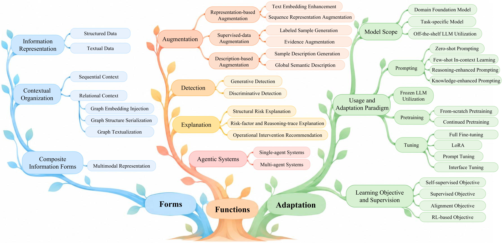

<h1 align="center">📚 Awesome Fraud Detection</h1>

  
  
  
  
  

A growing collection of research papers, code, and datasets for fraud detection.

## 🎓 Our Survey Papers

- **🏆 Graph Neural Networks for Financial Fraud Detection: A Review (Frontiers of Computer Science 2025)** [[Paper]](https://link.springer.com/article/10.1007/s11704-024-40474-y) | [[Cite]](#citing)
- **📜 Large Language Models and Foundation Models for Fraud Detection** *(Paper link coming soon)*

## 🧭 Content

- **[LLMs and Foundation Models for Fraud Detection](#llm-foundation-models)** : [LLMs](#llms-for-fraud) | [Foundation Models](#foundation-models) | [Agentic](#agentic-fraud)
- **[Graph-based Fraud Detection](#graph-based)** : [2026](#graph-2026) | [2025](#graph-2025) | [2024](#graph-2024) | [2023](#graph-2023) | [2022](#graph-2022) | [2021](#graph-2021) | [2020](#graph-2020) | [2019](#graph-2019) | [2018](#graph-2018) | [2017](#graph-2017)

- **[Datasets](#datasets)** : [Graph-based Fraud Datasets](#graph-fraud-datasets) | [Financial Transaction Datasets](#financial-transaction-datasets)

## 🌐 LLMs and Foundation Models for Fraud Detection

### 📌 Research Overview

  

<strong>🌳 Unified Taxonomy: Forms, Functions, and Usage and Adaptation</strong>

  

### 💡 LLMs for Fraud Detection

- **DGP: a dual-granularity prompting framework for fraud detection with graph-enhanced LLMs (AAAI 2026)** [[Paper]](https://dl.acm.org/doi/10.1609/aaai.v40i18.38541)

  *Li, Yuan and Hu, Jun and Hooi, Bryan and He, Bingsheng and Chen, Cheng.*

- **Targeting Borderline Fraudsters: Multi-View Hypergraph Fraud Detection with LLM-Guided Contrastive Learning (AAAI 2026)** [[Paper]](https://doi.org/10.1609/aaai.v40i18.38588)

  *Ou, R., Zhu, K., Zhang, N., Li, J., Chen, C., Xu, Y., & Jiang, C.*

- **ICAD-LLM: One-for-All Anomaly Detection via In-Context Learning with Large Language Models (AAAI 2026)** [[Paper]](https://ojs.aaai.org/index.php/AAAI/article/view/38632)

  *Wu, Zhongyuan and Wang, Jingyuan and Cheng, Zexuan and Zhou, Yilong and Wang, Weizhi and Pu, Juhua and Li, Chao and Ma, Changqing.*

- **Understanding Structured Financial Data with LLMs: A Case Study on Fraud Detection (ACL 2026)** [[Paper]](https://aclanthology.org/2026.acl-long.1071.pdf)

  *Xuwei Tan, Yao Ma, Xueru Zhang.*

- **Think-like-LSTM: Memory-Augmented Large Language Models via Dynamic Fine-Tuning for Financial Risk Assessment (KDD 2026)** [[Paper]](https://dl.acm.org/doi/epdf/10.1145/3770855.3818491)

  *Siwei Zhang, Yun Xiong, Xi Chen, Yateng Tang, Zi'an Jia, Xuehao Zheng, Jiarong Xu.*

- **Reinforcement Learning of Large Language Models for Interpretable Credit Card Fraud Detection (arXiv 2026)** [[Paper]](https://arxiv.org/abs/2601.05578)

  *Cooper Lin, Yanting Zhang, Maohao Ran, Wei Xue, Hongwei Fan, Yibo Xu, Zhenglin Wan, Sirui Han, Yike Guo, Jun Song.*

- **OCR-APT: Reconstructing APT Stories from Audit Logs using Subgraph Anomaly Detection and LLMs (CCS 2025)** [[Paper]](https://dl.acm.org/doi/epdf/10.1145/3719027.3765219)

  *Aly, Ahmed and Mansour, Essam and Youssef, Amr.*

- **AnoLLM: Large Language Models for Tabular Anomaly Detection (ICLR 2025)** [[Paper]](https://openreview.net/pdf?id=7VkHffT5X2)

  *Che-Ping Tsai, Ganyu Teng, Phillip Wallis, Wei Ding.*

- **Ethereum Fraud Detection via Joint Transaction Language Model and Graph Representation Learning (Information Fusion 2025)** [[Paper]](https://www.sciencedirect.com/science/article/abs/pii/S1566253525001472) | [[Code]](https://github.com/lincozz/TLmGNN)

  *Sun, Jianguo and Jia, Yifan and Wang, Yanbin and Tian, Ye and Zhang, Sheng.*

- **GuARD: Effective Anomaly Detection through a Text-Rich and Graph-Informed Language Model (KDD 2025)** [[Paper]](https://dl.acm.org/doi/epdf/10.1145/3711896.3736993)

  *Pang, Yunhe and Chen, Bo and Zhang, Fanjin and Rao, Yanghui and Kharlamov, Evgeny and Tang, Jie.*

- **FLAG: Fraud Detection with LLM-enhanced Graph Neural Network (KDD 2025)** [[Paper]](https://dl.acm.org/doi/epdf/10.1145/3711896.3737220)

  *Yang, Chengdong and Liu, Hongrui and Wang, Daixin and Zhang, Zhiqiang and Yang, Cheng and Shi, Chuan.*

- **Can LLMs Find Fraudsters? Multi-level LLM Enhanced Graph Fraud Detection (MM 2025)** [[Paper]](https://dl.acm.org/doi/epdf/10.1145/3746027.3755245)

  *Huang, Tairan and Wang, Yili and Li, Qiutong and He, Changlong and Gao, Jianliang.*

- **What Does the Bot Say? Opportunities and Risks of Large Language Models in Social Media Bot Detection (ACL 2024)** [[Paper]](https://aclanthology.org/2024.acl-long.196.pdf)

  *Shangbin Feng, Herun Wan, Ningnan Wang, Zhaoxuan Tan, Minnan Luo, Yulia Tsvetkov.*

- **LMBot: Distilling Graph Knowledge into Language Model for Graph-less Deployment in Twitter Bot Detection (WSDM 2024)** [[Paper]](https://dl.acm.org/doi/epdf/10.1145/3616855.3635843)

  *Cai, Zijian and Tan, Zhaoxuan and Lei, Zhenyu and Zhu, Zifeng and Wang, Hongrui and Zheng, Qinghua and Luo, Minnan.*

- **Fighting Fire with Fire: The Dual Role of LLMs in Crafting and Detecting Elusive Disinformation (EMNLP 2023)** [[Paper]](https://aclanthology.org/2023.emnlp-main.883.pdf) | [[Code]](https://github.com/mickeymst/F3)

  *Jason Lucas, Adaku Uchendu, Michiharu Yamashita, Jooyoung Lee, Shaurya Rohatgi, Dongwon Lee.*

### 🧠 Foundation Models

- **TREASURE: A Transformer-Based Foundation Model for High-Volume Transaction Understanding (KDD 2026)** [[Paper]](https://dl.acm.org/doi/epdf/10.1145/3770854.3783942)

  *Yeh, Chin-Chia Michael and Singh Saini, Uday and Dai, Xin and Fan, Xiran and Jain, Shubham and Fan, Yujie and Sun, Jiarui and Wang, Junpeng and Pan, Menghai and Dou, Yingtong and Chen, Yuzhong and Rakesh, Vineeth and Wang, Liang and Zheng, Yan and Das, Mahashweta.*

- **TransactionGPT: Toward Foundational Transaction Modeling (KDD 2026)** [[Paper]](https://dl.acm.org/doi/epdf/10.1145/3770855.3818496)

  *Yingtong Dou, Zhimeng Jiang, Tianyi Zhang, Mingzhi Hu, Zhichao Xu, Huiyuan Chen, Shubham Jain, Uday Singh Saini, Xiran Fan, Jiarui Sun, Menghai Pan, Junpeng Wang, Chin-Chia Michael Yeh, Xin Dai, Yuzhong Chen.*

- **Query as Anchor: Scenario-Adaptive User Representation via Large Language Model (KDD 2026)** [[Paper]](https://dl.acm.org/doi/epdf/10.1145/3770855.3818464) | [[Code]](https://github.com/JhCircle/Q-Anchor)

  *Jiahao Yuan, Yike Xu, Jinyong Wen, Baokun Wang, Ziyi Gao, Xiaotong Lin, Yun Liu, Xing Fu, Yu Cheng, Yongchao Liu, Weiqiang Wang, Zhongle Xie.*

- **FRiskGPT: A Generative Foundation Model for Financial Risk Detection (WWW 2026)** [[Paper]](https://dl.acm.org/doi/epdf/10.1145/3774904.3792832)

  *Zhang, Zhongjian and Zhang, Mengmei and Xu, Dehua and Shi, Rongjun and Liu, Jianfeng and Meng, Fuli and Xu, Huajian and Wang, Xiao and Wang, Ruijia and Chen, Junze and Tang, Minwei and Shi, Chuan.*

- **SeqLLM: Augmenting LLMs with Behavioral-Sequence Modeling for High-Stakes Decisions at WeChat Pay (arXiv 2026)** [[Paper]](https://arxiv.org/abs/2608.03063) | [[Code]](https://github.com/125jx/SeqLLM) 

  *Guilin Li, Jiaxing Zhang, Matthias Hwai Yong Tan, Bo Wang, Weiran Huang.*

- **PRAGMA: Revolut Foundation Model (arXiv 2026)** [[Paper]](https://arxiv.org/abs/2604.08649)

  *Maxim Ostroukhov, Ruslan Mikhailov, Vladimir Iashin, Artem Sokolov, Andrei Akshonov, Vitaly Protasov, Dmitrii Beloborodov, Vince Mullin, Roman Yokunda Enzmann, Georgios Kolovos, Jason Renders, Pavel Nesterov, Anton Repushko.*

- **Enhancing Foundation Models in Transaction Understanding with LLM-based Sentence Embeddings (EMNLP 2025)** [[Paper]](https://aclanthology.org/2025.emnlp-industry.61.pdf)

  *Xiran Fan, Zhimeng Jiang, Chin-Chia Michael Yeh, Yuzhong Chen, Yingtong Dou, Menghai Pan, Yan Zheng.*

- **PANTHER: Generative Pretraining Beyond Language for Sequential User Behavior Modeling (NeurIPS 2025)** [[Paper]](https://openreview.net/pdf?id=4FUdUFvvmp)

  *Guilin_Li, Yun Zhang, Xiuyuan Chen, Chengqi Li, Bo Wang, Linghe Kong, Wenjia Wang, Weiran Huang, Matthias Hwai Yong Tan.*

- **Open Banking Foundational Model: Learning Language Representations from Few Financial Transactions (arXiv 2025)** [[Paper]](https://arxiv.org/abs/2511.12154)

  *Gustavo Polleti, Marlesson Santana, Eduardo Fontes.*

> **Early Transformer-based Behavioral Modeling.** These studies focus on transformer architectures and task-oriented behavioral pretraining, providing context for the development of financial foundation models.

- **SSH-T3: A Hierarchical Pre-training Framework for Multi-Scenario Financial Risk Assessment (CIKM 2025)** [[Paper]](https://dl.acm.org/doi/epdf/10.1145/3746252.3761504)

  *Gu, Zehao and Tang, Yateng and Xu, Jiarong and Siwei, Zhang and Zheng, Xuehao and Chen, Xi and Xiong, Yun.*

- **One transformer for all time series: representing and training with time-dependent heterogeneous tabular data (Machine Learning 2025)** [[Paper]](https://link.springer.com/article/10.1007/s10994-025-06778-1) | [[Code]](https://github.com/fabriziogaruti/UniTTab)

  *Luetto, Simone and Garuti, Fabrizio and Sangineto, Enver and Forni, Lorenzo and Cucchiara, Rita.*

- **FATA-Trans: Field And Time-Aware Transformer for Sequential Tabular Data (CIKM 2023)** [[Paper]](https://dl.acm.org/doi/epdf/10.1145/3583780.3614879) | [[Code]](https://github.com/zdy93/FATA-Trans)

  *Zhang, Dongyu and Wang, Liang and Dai, Xin and Jain, Shubham and Wang, Junpeng and Fan, Yujie and Yeh, Chin-Chia Michael and Zheng, Yan and Zhuang, Zhongfang and Zhang, Wei.*

- **Robust User Behavioral Sequence Representation via Multi-scale Stochastic Distribution Prediction (CIKM 2023)** [[Paper]](https://dl.acm.org/doi/epdf/10.1145/3583780.3614714)

  *Fu, Chilin and Wu, Weichang and Zhang, Xiaolu and Hu, Jun and Wang, Jing and Zhou, Jun.*

### 🤖 Agentic Fraud Detection

- **LLM as an Algorithmist: Enhancing Anomaly Detectors via Programmatic Synthesis (ICLR 2026)** [[Paper]](https://openreview.net/pdf?id=5rV8ML7Q3r)

  *Hangting Ye, Jinmeng Li, He Zhao, Mingchen Zhuge, Dandan Guo, Yi Chang, Hongyuan Zha.*

- **SHERLOCK: Towards Dynamic Knowledge Adaptation in LLM-enhanced E-commerce Risk Management (KDD 2026)** [[Paper]](https://dl.acm.org/doi/epdf/10.1145/3770855.3818480)

  *Nan Lu, Yurong Hu, Jiaquan Fang, Yan Liu, Rui Dong, Yiming Wang, Rui Lin, Shaoyi Xu.*

- **LLM-Enhanced Self-Evolving Reinforcement Learning for Multi-Step E-Commerce Payment Fraud Risk Detection (ACL 2025)** [[Paper]](https://aclanthology.org/2025.acl-industry.9.pdf)

  *Bo Qu, Zhurong Wang, Daisuke Yagi, Zach Xu, Yang Zhao, Yinan Shan, Frank Zahradnik.*

> **Recent Preprints.** These studies are currently available as preprints and highlight recent advances in agentic fraud detection.

- **SAGE: An LLM-driven Self Reflective Agentic Framework for Fraud Detection (arXiv 2026)** [[Paper]](https://arxiv.org/abs/2606.08146)

  *Yichen Chen, Siying Li, Yuhang Liang, Lijun Wang, Renyang Liu.*

- **FAA Framework: A Large Language Model-Based Approach for Credit Card Fraud Investigations (arXiv 2026)** [[Paper]](https://arxiv.org/abs/2506.11635)

  *Shaun Shuster, Eyal Zaloof, Asaf Shabtai, Rami Puzis.*

## 🕸️ Graph-based Fraud Detection

### 🗓️ 2026

- **Defending Attacks on Anti-Fraud Model With Generative Graph Representations (TKDE)** [[Paper]](https://ieeexplore.ieee.org/document/11278752)

  *Jiasheng Wu, Xincheng Wang, Jie Yang, Dawei Cheng, Guang Yang, Bo Wang*

- **Empowering Credit Risk Detection in Weixin Pay with Billion-Scale Deep Graph Learning (KDD)** [[Paper]](https://dl.acm.org/doi/pdf/10.1145/3770855.3818397)

  *Xin Liu, Xiyuan Chen, Chenglong Wu, Xuan Zong, Jun Zhou, Dawei Cheng*

- **Role Perceptual Augmented Temporal Graph Network for Related-party Transaction Detection (AAAI)** [[Paper]](https://ojs.aaai.org/index.php/AAAI/article/view/41240)

  *Xin Liu, Yuanhang Yu, Peng Zhu, Dawei Cheng, Changjun Jiang*

- **Deep Reinforcement Learning Enhanced Semi-supervised Graph Neural Network for Credit Card Fraud Detection (IJCAI)** [[Paper]](https://ijcai.org/proceedings/2026/801)

  *Huilin He, Kun Zhu, Zewen Hu, Jie Wang, Dawei Cheng*

### 🗓️ 2025

- **Global Attribute-Association Pattern Aggregation for Graph Fraud Detection (AAAI)** [[Paper]](https://ojs.aaai.org/index.php/AAAI/article/view/33264) [[Code]](https://github.com/AtwoodDuan/GAAP)

  *Mingjiang Duan, Da He, Tongya Zheng, Lingxiang Jia, Mingli Song, Xinyu Wang, Zunlei Feng*

- **Context-aware Graph Neural Network for Graph-based Fraud Detection with Extremely Limited Labels (AAAI)** [[Paper]](https://ojs.aaai.org/index.php/AAAI/article/view/33319)

  *Pengbo Li, Hang Yu, Xiangfeng Luo*

- **A Label-free Heterophily-guided Approach for Unsupervised Graph Fraud Detection (AAAI)** [[Paper]](https://ojs.aaai.org/index.php/AAAI/article/view/33356)

  *Junjun Pan, Yixin Liu, Xin Zheng, Yizhen Zheng, Alan Wee-Chung Liew, Fuyi Li, Shirui Pan*

- **Dynamic Neighborhood Modeling via Node-Subgraph Contrastive Learning for Graph-Based Fraud Detection (AAAI)** [[Paper]](https://ojs.aaai.org/index.php/AAAI/article/view/33431)

  *Zhizhi Yu, Chundong Liang, Xinglong Chang, Dongxiao He, Di Jin, Jianguo Wei*

- **Unveiling the Threat of Fraud Gangs to Graph Neural Networks: Multi-Target Graph Injection Attacks Against GNN-Based Fraud Detectors (AAAI)** [[Paper]](https://ojs.aaai.org/index.php/AAAI/article/view/33760)

  *Jinhyeok Choi, Heehyeon Kim, Joyce Jiyoung Whang*

- **Mitigating Message Imbalance in Fraud Detection with Dual-View Graph Representation Learning (IJCAI)** [[Paper]](https://www.ijcai.org/proceedings/2025/365)

  *Yudan Song, Yuecen Wei, Yuhang Lu, Qingyun Sun, Minglai Shao, Li-e Wang, Chunming Hu, Xianxian Li, Xingcheng Fu*

- **MutationGuard: A Graph and Temporal-Spatial Neural Method for Detecting Mutation Telecommunication Fraud (IJCAI)** [[Paper]](https://www.ijcai.org/proceedings/2025/1061)

  *Haitao Bai, Pinghui Wang, Ruofei Zhang, Ziyang Zhou, Juxiang Zeng, Yulou Su, Li Xing, Zhou Su, Chen Zhang, Lizhen Cui, Jun Hao, Wei Wang*

- **Temporal Insights for Group-Based Fraud Detection on e-Commerce Platforms (TKDE)** [[Paper]](https://ieeexplore.ieee.org/document/10740556)

  *Jianke Yu, Hanchen Wang, Xiaoyang Wang, ZhaoLi, LuQin, Wenjie Zhang, Jian Liao, Ying Zhang, Bailin Yang*

- **Nowhere to H^2IDE: Fraud Detection From Multi-Relation Graphs via Disentangled Homophily and Heterophily Identification (TKDE)** [[Paper]](https://ieeexplore.ieee.org/document/10816539)

  *Chao Fu, Guannan Liu, KunYuan, Junjie Wu*

- **Mitigating the Tail Effect in Fraud Detection by Community Enhanced Multi-Relation Graph Neural Networks (TKDE)** [[Paper]](https://ieeexplore.ieee.org/document/10843290)

  *Li Han, Longxun Wang, Ziyang Cheng, Bo Wang, Guang Yang, Dawei Cheng, Xuemin Lin*

- **Enhancing Attribute-Driven Fraud Detection With Risk-Aware Graph Representation (TKDE)** [[Paper]](https://ieeexplore.ieee.org/document/10896835)

  *Sheng Xiang, Guibin Zhang, Dawei Cheng, Ying Zhang*

- **Grad: Guided Relation Diffusion Generation for Graph Augmentation in Graph Fraud Detection (WWW)** [[Paper]](https://dl.acm.org/doi/10.1145/3696410.3714520)

  *Jie Yang, Rui Zhang, Ziyang Cheng, Dawei Cheng, Guang Yang, Bo Wang*

- **Multi-Granularity Augmented Graph Learning for Spoofing Transaction Detection (WWW)** [[Paper]](https://dl.acm.org/doi/pdf/10.1145/3696410.3714521)

  *Xin Liu, Haojun Rui, Dawei Cheng, Li Han, Zhongyun Zhou, Guoping Zhao*

- **Innovative Graph-Based Analysis to Counter VAT Carousel and Credit Card Frauds (ICDM)** [[Paper]](https://ieeexplore.ieee.org/document/11416093)

  *Rafał Kozik, Piotr Gocał, Michał Choraś*

- **Neighbor-enhanced Graph Pre-training and Prompt Learning Framework for Fraud Detection (CIKM)** [[Paper]](https://dl.acm.org/doi/10.1145/3746252.3761588)

  *Ziyang Cheng, Jie Yang, Yixin Song, Dawei Cheng, Guang Yang, Bo Wang*

- **MultiScale Spectral GNN for Fraud Detection (ASONAM)** [[Paper]](https://link.springer.com/chapter/10.1007/978-3-032-13821-7_15)

  *Melike Yildiz Aktas, Mustafa Coskun, Chang-Tien Lu*

- **Multi-Temporal Partitioned Graph Attention Networks for Financial Fraud Detection (TIFS)** [[Paper]](https://ieeexplore.ieee.org/stamp/stamp.jsp?tp=&arnumber=11153605)

  *Mingjian Guang, Zhong Li, Chungang Yan, Yuhua Xu, Junli Wang, Dawei Cheng, Changjun Jiang*

- **Homophily Edge Augment Graph Neural Network for High-Class Homophily Variance Learning (TPAMI)** [[Paper]](https://ieeexplore.ieee.org/stamp/stamp.jsp?tp=&arnumber=11278786)

  *Minjian Guang, Rui Zhang, Dawei Cheng, Xiaoyang Wang, Xin Liu, Jie Yang, Yi Ouyang, Xian Wu, Yefeng Zheng*

### 🗓️ 2024

- **Revisiting Graph-Based Fraud Detection in Sight of Heterophily and Spectrum (AAAI)** [[Paper]](https://ojs.aaai.org/index.php/AAAI/article/view/28773) [[Code]](https://github.com/Sunxkissed/SEC-GFD)

  *Fan Xu, Nan Wang, Hao Wu, Xuezhi Wen, Xibin Zhao, Hai Wan*

- **Barely Supervised Learning for Graph-Based Fraud Detection (AAAI)** [[Paper]](https://ojs.aaai.org/index.php/AAAI/article/view/29593)

  *Hang Yu, Zhengyang Liu, Xiangfeng Luo*

- **SEFraud: Graph-based Self-Explainable Fraud Detection via Interpretative Mask Learning (KDD)** [[Paper]](https://dl.acm.org/doi/10.1145/3637528.3671534)

  *Kaidi Li, Tianmeng Yang, Min Zhou, Jiahao Meng, Shendi Wang, Yihui Wu, Boshuai Tan, Hu Song, Lujia Pan, Fan Yu, Zhenli Sheng, Yunhai Tong*

- **Cross-Regional Fraud Detection via Continual Learning With Knowledge Transfer (TKDE)** [[Paper]](https://ieeexplore.ieee.org/document/10654781)

  *Yujie Li, XinYang, QiangGao, Hao Wang, Junbo Zhang, TianruiLi*

- **Spade+: A Generic Real-Time Fraud Detection Framework on Dynamic Graphs (TKDE)** [[Paper]](https://ieeexplore.ieee.org/document/10510636)

  *Jiaxin Jiang, Yuhang Chen, Bingsheng He, Min Chen, Jia Chen*

- **Burstiness-aware Bipartite Graph Neural Networks for Fraudulent User Detection on Rating Platforms (WWW)** [[Paper]](https://dl.acm.org/doi/10.1145/3589335.3651475)

  *Yen-Wen Lu, Yu-Che Tsai, Cheng-Te Li*

- **TROPICAL: Transformer-Based Hypergraph Learning for Camouflaged Fraudster Detection (ICDM)** [[Paper]](https://ieeexplore.ieee.org/document/10884140) [[Code]](https://github.comNenusHaghighi/TROPICAL)

  *Venus Haghighi, Behnaz Soltani, Nasrin Shabani, Jia Wu, Yang Zhang, Lina Yao, Quan Z. Sheng, Jian Yang*

- **Collaborative Fraud Detection on Large Scale Graph Using Secure Multi-Party Computation (CIKM)** [[Paper]](https://dl.acm.org/doi/10.1145/3627673.3679863)

  *Xin Liu, Xiaoyu Fan, Rong Ma, Kun Chen, Yi Li, Guosai Wang, Wei Xu*

- **LEX-GNN: Label-Exploring Graph Neural Network for Accurate Fraud Detection (CIKM)** [[Paper]](https://dl.acm.org/doi/10.1145/3627673.3679956) [[Code]](https://github.com/wdhyun/LEX-GNN)

  *Woochang Hyun, Insoo Lee, Bongwon Suh*

- **Graph-theoretical Approach to Enhance Accuracy of Financial Fraud Detection Using Synthetic Tabular Data Generation (CIKM)** [[Paper]](https://dl.acm.org/doi/10.1145/3627673.3680267)

  *Dae-Young Park*

- **Parallel Graph Learning with Temporal Stamp Encoding for Fraudulent Transactions Detections (IEEE T-BD)** [[Paper]](https://ieeexplore.ieee.org/abstract/document/10753618/)

  *Jiacheng Ma, Sheng Xiang, Qiang Li, Liangyu Yuan, Dawei Cheng, Changjun Jiang*

- **Subgraph Patterns Enhanced Graph Neural Network for Fraud Detection (DASFAA)** [[Paper]](https://link.springer.com/chapter/10.1007/978-981-97-5572-1_26)

  *Yao Zou, Sheng Xiang, Qijun Miao, Dawei Cheng, Changjun Jiang* 

- **Effective High-order Graph Representation Learning for Credit Card Fraud Detection (IJCAI)** [[Paper]](https://arxiv.org/pdf/2503.01556) [[Code]](https://github.com/finint/antifraud) 

  *Yao Zou, Dawei Cheng* 

- **Safeguarding Fraud Detection from Attacks: A Robust Graph Learning Approach (IJCAI)** [[Paper]](https://www.ijcai.org/proceedings/2024/0830.pdf) 

  *Jiasheng Wu, Xin Liu, Dawei Cheng, Yi Ouyang, Xian Wu, Yefeng Zheng* 

- **Pre-trained Online Contrastive Learning for Insurance Fraud Detection (AAAI)** [[Paper]](https://doi.org/10.1609/aaai.v38i20.30259)  [[Code]](https://github.com/AI4Risk/POCL)

  *Rui Zhang, Dawei Cheng, Jie Yang, Yi Ouyang, Xian Wu, Yefeng Zheng, Changjun Jiang*

    

- **Partitioning Message Passing for Graph Fraud Detection (ICLR)** [[Paper]](https://openreview.net/pdf?id=tEgrUrUuwA) [[Code]](https://github.com/Xtra-Computing/PMP)

  *Wei Zhuo , Zemin Liu , Bryan Hooi, Bingsheng He, Guang Tan, Rizal Fathony , Jia Chen*

- **Consistency Training with Learnable Data Augmentation for Graph Anomaly Detection with Limited Supervision (ICLR)** [[Paper]](https://openreview.net/pdf?id=elMKXvhhQ9) [[Code]](https://github.com/Xtra-Computing/ConsisGAD)

  *Nan Chen , Zemin Liu , Bryan Hooi , Bingsheng He , Rizal Fathony , Jun Hu , Jia Chen*

- **Boosting Graph Anomaly Detection with Adaptive Message Passing (ICLR)** [[Paper]](https://openreview.net/pdf?id=CanomFZssu) [[Code]](https://github.com/PasaLab/GADAM)

  *Jingyan Chen, Guanghui Zhu , Chunfeng Yuan, Yihua Huang*

- **DGA-GNN: Dynamic Grouping Aggregation GNN for Fraud Detection (AAAI)** [[Paper]](https://ojs.aaai.org/index.php/AAAI/article/view/29067) [[Code]](https://github.com/AtwoodDuan/DGA-GNN)

  *Mingjiang Duan, Tongya Zheng, Yang Gao , Gang Wang, Zunlei Feng, Xinyu Wang*

- **DiG-In-GNN: Discriminative Feature Guided GNN-Based Fraud Detector against Inconsistencies in Multi-Relation Fraud Graph (AAAI)** [[Paper]](https://ojs.aaai.org/index.php/AAAI/article/view/28785) [[Code]](https://github.com/GraphBerry/DiG-In-GNN)

  *Jinghui Zhang, Zhengjia Xu, Dingyang Lv, Zhan Shi, Dian Shen, Jiahui Jin, Fang Dong*

### 🗓️ 2023

- **Semi-supervised Credit Card Fraud Detection via Attribute-driven Graph Representation (AAAI)** [[Paper]](https://www.xiangshengcloud.top/publication/semi-supervised-credit-card-fraud-detection-via-attribute-driven-graph-representation/Sheng-AAAI2023.pdf) [[Code]](https://github.com/finint/antifraud)

  *Sheng Xiang, Mingzhi Zhu, Dawei Cheng, Enxia Li, Ruihui Zhao, Yi Ouyang, Ling Chen, Yefeng Zheng*

    

- **FIW-GNN: A Heterogeneous Graph-Based Learning Model for Credit Card Fraud Detection (DSAA)** [[Paper]](https://ieeexplore.ieee.org/abstract/document/10302538)

  *Yan, Kuan, Gao, Junbin, Matsypura, Dmytro*

- **Unsupervised Fraud Transaction Detection on Dynamic Attributed Networks (DSAA)** [[Paper]](https://link.springer.com/chapter/10.1007/978-3-031-30678-5_41)

  *Yangyang Hou, Daixin Wang, Binbin Hu, Ruoyu Zhuang, Zhiqiang Zhang, Jun Zhou, Feng Zhao, Yulin Kang, Zhanwen Qiao*

- **Dynamic graph neural network-based fraud detectors against collaborative fraudsters (KBS)** [[Paper]](https://www.sciencedirect.com/science/article/abs/pii/S095070512300638X)

  *Lingfei Ren, Ruimin Hu, Dengshi Li, Yang Liu, Junhang Wu, Yilong Zang, Wenyi Hu*

- **Anti-Money Laundering by Group-Aware Deep Graph Learning (TKDE)** [[Paper]](https://doi.org/10.1109/TKDE.2023.3272396)

  *Dawei Cheng, Yujia Ye, Sheng Xiang, Zhenwei Ma, Ying Zhang, Changjun Jiang*

- **Realistic Synthetic Financial Transactions for Anti-Money Laundering Models (NeurIPS)** [[Paper]](https://proceedings.neurips.cc/paper_files/paper/2023/hash/5f38404edff6f3f642d6fa5892479c42-Abstract-Datasets_and_Benchmarks.html)

  *Erik Altman, Jovan Blanuša, Luc von Niederhäusern, Beni Egressy, Andreea Anghel, Kubilay Atasu*

- **MIDLG: Mutual Information based Dual Level GNN for Transaction Fraud Complaint Verification (KDD)** [[Paper]](https://dl.acm.org/doi/abs/10.1145/3580305.3599865)

  *Wen Zheng, Bingbing Xu, Emiao Lu, Yang Li, Qi Cao, Xuan Zong, and Huawei Shen*

- **Internet Financial Fraud Detection Based on Graph Learning (IEEE T-CSS)** [[Paper]](https://ieeexplore.ieee.org/abstract/document/9831118)

  *Ranran Li , Zhaowei Liu , Yuanqing Ma, Dong Yang, Shuaijie Sun*

- **Removing Camouflage and Revealing Collusion: Leveraging Gang-crime Pattern in Fraudster Detection (KDD-ADS)** [[Paper]](https://dl.acm.org/doi/abs/10.1145/3580305.3599895) [[Code]](https://github.com/lwwang1995/ACD)

  *L Wang, H Zhao, C Feng, W Liu, C Huang, M Santoni, M Cristofaro, P Jafrancesco, J Bian*

- **Diga: Guided Diffusion Model for Graph Recovery in Anti-Money Laundering (KDD-ADS)** [[Paper]](https://dl.acm.org/doi/pdf/10.1145/3580305.3599806)

  *X Li, Y Li, X Mo, H Xiao, Y Shen, L Chen*

- **Label Information Enhanced Fraud Detection against Low Homophily in Graphs (WWW)** [[Paper]](https://arxiv.org/pdf/2302.10407) [[Code]](https://github.com/hoangdzung/GAGA/tree/master)

  *Yuchen Wang, Jinghui Zhang, Zhengjie Huang, Weibin Li, Shikun Feng, Ziheng Ma, Yu Sun, Dianhai Yu, Fang Dong, Jiahui Jin, Beilun Wang, Junzhou Luo*

###  🗓️ 2022

- **Explainable Graph-based Fraud Detection via Neural Meta-graph Search (CIKM)** [[Paper]](https://dl.acm.org/doi/pdf/10.1145/3511808.3557598)

  *Zidi Qin, Yang Liu, Qing He, Xiang Ao*

- **The Importance of Future Information in Credit Card Fraud Detection (AISTATS)** [[Paper]](https://arxiv.org/abs/2204.05265)

  *Van Bach Nguyen, Kanishka Ghosh Dastidar, Michael Granitzer, Wissam Siblini*

- **Inductive Graph Representation Learning for fraud detection (ESWA)** [[Paper]](https://www.sciencedirect.com/science/article/abs/pii/S0957417421017449)

  *Rafaël Van Belle, Charles Van Damme, Hendrik Tytgat, Jochen De Weerdt*

- **Inspection-L: self-supervised GNN node embeddings for money laundering detection in bitcoin (ArXiv)** [[Paper]](https://doi.org/10.1007/s10489-023-04504-9)

  *Wai Weng Lo, Gayan K. Kulatilleke, Mohanad Sarhan, Siamak Layeghy, Marius Portmann*

- **BRIGHT - Graph Neural Networks in Real-time Fraud Detection (CIKM)** [[Paper]](https://arxiv.org/abs/2205.13084)

  *Mingxuan Lu, Zhichao Han, Susie Xi Rao, Zitao Zhang, Yang Zhao, Yinan Shan, Ramesh Raghunathan, Ce Zhang, Jiawei Jiang*

- **Ethereum Fraud Detection with Heterogeneous Graph Neural Networks (KDD)** [[Paper]](https://arxiv.org/abs/2203.12363)

  *Hiroki Kanezashi, Toyotaro Suzumura, Xin Liu, Takahiro Hirofuchi*

- **xFraud: Explainable Fraud Transaction Detection (ArXiv)** [[Paper]](https://arxiv.org/abs/2011.12193)

  *Susie Xi Rao, Shuai Zhang, Zhichao Han, Zitao Zhang, Wei Min, Zhiyao Chen, Yinan Shan, Yang Zhao, Ce Zhang*

- **ASA-GNN: Adaptive Sampling and Aggregation-Based Graph Neural Network for Transaction Fraud Detection (TCSS)** [[Paper]](https://ieeexplore.ieee.org/abstract/document/10354439)

  *Yue Tian, Guanjun Liu, Jiacun Wang, Mengchu Zhou*

- **Rethinking Graph Neural Networks for Anomaly Detection (ICML)** [[Paper]](https://proceedings.mlr.press/v162/tang22b.html) [[Code]](https://github.com/squareRoot3/Rethinking-Anomaly-Detection)

  *Tang, Jianheng and Li, Jiajin and Gao, Ziqi and Li, Jia*

    

- **H2-FDetector: A GNN-based Fraud Detector with Homophilic and Heterophilic Connections (WWW)** [[Paper]](https://dl.acm.org/doi/abs/10.1145/3485447.3512195) [[Code]](https://github.com/shifengzhao/H2-FDetector)

  *Shi, Fengzhao and Cao, Yanan and Shang, Yanmin and Zhou, Yuchen and Zhou, Chuan and Wu, Jia*

    

### 🗓️ 2021

- **CaT-GNN: Enhancing Credit Card Fraud Detection with Causal Time Graph Neural Networks (TKDE)** [[Paper]](https://arxiv.dosf.top/abs/2402.14708)

  *Yifan Duan, Guibin Zhang, Shilong Wang, Xiaojiang Peng, Wang Ziqi, Junyuan Mao, Hao Wu, Xinke Jiang, Kun Wang*

- **Towards Consumer Loan Fraud Detection: Graph Neural Networks with Role-Constrained Conditional Random Field (AAAI)** [[Paper]](https://ojs.aaai.org/index.php/AAAI/article/view/16582)

  *Bingbing Xu, Huawei Shen, Bing-Jie Sun, Rong An, Qi Cao, Xueqi Cheng*

- **Modeling the Field Value Variations and Field Interactions Simultaneously for Fraud Detection (AAAI)** [[Paper]](https://arxiv.org/abs/2008.05600)

  *Dongbo Xi, Bowen Song, Fuzhen Zhuang, Yongchun Zhu, Shuai Chen, Tianyi Zhang, Yuan Qi, Qing He*

- **Suspicious Massive Registration Detection via Dynamic Heterogeneous Graph Neural Networks (AAAI)** [[Paper]](https://arxiv.org/abs/2012.10831)

  *Susie Xi Rao, Shuai Zhang, Zhichao Han, Zitao Zhang, Wei Min, Mo Cheng, Yinan Shan, Yang Zhao, Ce Zhang*

- **Pick and Choose: A GNN-based Imbalanced Learning Approach for Fraud Detection (WWW)** [[Paper]](https://dl.acm.org/doi/abs/10.1145/3442381.3449989) [[Code]](https://github.com/PonderLY/PC-GNN)

  *Liu, Yang and Ao, Xiang and Qin, Zidi and Chi, Jianfeng and Feng, Jinghua and Yang, Hao and He, Qing*

   

- **FRAUDRE: Fraud Detection Dual-Resistant to Graph Inconsistency and Imbalance (ICDM)** [[Paper]](https://ieeexplore.ieee.org/abstract/document/9679178) [[Code]](https://github.com/FraudDetection/FRAUDRE)

  *Zhang, Ge and Wu, Jia and Yang, Jian and Beheshti, Amin and Xue, Shan and Zhou, Chuan and Sheng, Quan Z*

    

- **Anomaly Detection in Dynamic Graphs via Transformer (TKDE)** [[Paper]](https://ieeexplore.ieee.org/stamp/stamp.jsp?tp=&arnumber=9599560)

  *Y Liu, S Pan, YG Wang, F Xiong, L Wang, Q Chen, VCS Lee*

### 🗓️ 2020

- **Graph Neural Network for Fraud Detection via Spatial-Temporal Attention (TKDE)** [[Paper]](https://ieeexplore.ieee.org/abstract/document/9204584) [[Code]](https://github.com/finint/antifraud)

  *Dawei Cheng, Xiaoyang Wang, Ying Zhang, Liqing Zhang*

    

- **Parallel granular neural networks for fast credit card fraud detection (APIN)** [[Paper]](https://ieeexplore.ieee.org/abstract/document/1005055)

  *Syeda, M, Yan-Qing Zhang, Yi Pan*

- **FlowScope: Spotting Money Laundering Based on Graphs (AAAI)** [[Paper] ](https://shenghua-liu.github.io/papers/aaai2020cr-flowscope.pdf)[[Code]](https://github.com/aplaceof/FlowScope)

  *Xiangfeng Li, Shenghua Liu, Zifeng Li, Xiaotian Han, Chuan Shi, Bryan Hooi, He Huang, Xueqi Cheng*

- **Competence of Graph Convolutional Networks for Anti-Money Laundering in Bitcoin Blockchain (ICML)** [[Paper]](https://www.semanticscholar.org/paper/Competence-of-Graph-Convolutional-Networks-for-in-Alarab-Prakoonwit/1225bc8902daa95f0df8d6a84b3cfdd4a1cca31d)

  *Ismail Alarab, Simant Prakoonwit, Mohamed Ikbal Nacer*

- **Enhancing Graph Neural Network-based Fraud Detectors against Camouflaged Fraudsters (CIKM)** [[Paper]](https://dl.acm.org/doi/abs/10.1145/3340531.3411903) [[Code]](https://github.com/YingtongDou/CARE-GNN)

  *Dou, Yingtong and Liu, Zhiwei and Sun, Li and Deng, Yutong and Peng, Hao and Yu, Philip S.*

   

- **FlowScope: Spotting Money Laundering Based on Graphs (AAAI)** [[Paper] ](https://aaai.org/ojs/index.php/AAAI/article/download/5906/5762) [[Code]](https://github.com/csqjxiao/FlowScope)

  *Xiangfeng Li, Shenghua Liu, Zifeng Li, Xiaotian Han, Chuan Shi , Bryan Hooi, He Huang, Xueqi Cheng*

### 🗓️ 2019

- **Uncovering insurance fraud conspiracy with network learning (SIGIR)** [[Paper]](https://dl.acm.org/doi/abs/10.1145/3331184.3331372)

  *Chen Liang, Ziqi Liu, Bin Liu, Jun Zhou, Xiaolong Li, Shuang Yang, and Yuan Qi*

- **Anti-Money Laundering in Bitcoin: Experimenting with Graph Convolutional Networks for Financial Forensics (SIGKDD)** [[Paper]](https://arxiv.org/abs/1908.02591)

  *Mark Weber, Giacomo Domeniconi, Jie Chen, Daniel Karl I. Weidele, Claudio Bellei, Tom Robinson, Charles E. Leiserson*

- **Cash-Out User Detection Based on Attributed Heterogeneous Information Network with a Hierarchical Attention Mechanism (AAAI)** [[Paper]](https://ojs.aaai.org/index.php/AAAI/article/view/3884)

  *Binbin Hu, Zhiqiang Zhang, Chuan Shi, Jun Zhou, Xiaolong Li, Yuan Qi*

- **Auto-encoder based Graph Convolutional Networks for Online Financial Anti-fraud (ICEFr)** [[Paper]](https://ieeexplore.ieee.org/abstract/document/8759109)

  *Lv, Le and Cheng, Jianbo and Peng, Nanbo and Fan, Min and Zhao, Dongbin, Zhang, Jianhong*

### 🗓️ 2018

- **Scalable Graph Learning for Anti-Money Laundering: A First Look (ArXiv)** [[Paper]](https://www.semanticscholar.org/paper/Scalable-Graph-Learning-for-Anti-Money-Laundering%3A-Weber-Chen/435a772dc696de13a185e33e80dd7fe71b25dcf0)

  *Mark Weber, Jie Chen, Toyotaro Suzumura, Aldo Pareja, Tengfei Ma, Hiroki Kanezashi, Tim Kaler, Charles E. Leiserson, Tao B. Schardl*

- **Heterogeneous Graph Neural Networks for Malicious Account Detection (CIKM)** [[Paper]](https://dl.acm.org/doi/abs/10.1145/3269206.3272010)

  *Ziqi Liu, Chaochao Chen, Xinxing Yang, Jun Zhou, Xiaolong Li, and Le Song*

### 🗓️ 2017

- **Graph Mining assisted Semi-supervised Learning for Fraudulent Cash-out Detection (KDD)** [[Paper]](https://dl.acm.org/doi/abs/10.1145/3110025.3110099)

  *Yuan Li, Yiheng Sun, and Noshir Contractor*

## 🗃️ Datasets

**Graph-based Fraud Datasets**

- Yelp-Fraud: https://github.com/YingtongDou/CARE-GNN/tree/master/data
- Amazon-Fraud: https://github.com/YingtongDou/CARE-GNN/tree/master/data
- T-Finance: https://drive.google.com/drive/folders/1DKO8edxNJ3UUWq-w2f6mLlKecr1itEUr
- T-Social: https://drive.google.com/drive/folders/1DKO8edxNJ3UUWq-w2f6mLlKecr1itEUr
- DGraph: https://dgraph.xinye.com/dataset
- Yelp Reviews: https://www.kaggle.com/datasets/yelp-dataset
- Amazon Reviews: https://amazon-reviews-2023.github.io/

**Financial Transaction Datasets**

*Real-world Datasets*

- IEEE-CIS: https://www.kaggle.com/c/ieee-fraud-detection/overview
- Credit Card Fraud: https://www.kaggle.com/datasets/mlg-ulb/creditcardfraud
- FraudEcom: https://www.kaggle.com/datasets/vbinh002/fraud-ecommerce
- Elliptic++: https://drive.google.com/drive/folders/1MRPXz79Lu_JGLlJ21MDfML44dKN9R08l

*Synthetic Datasets*

- Sparkov: https://www.kaggle.com/datasets/kartik2112/fraud-detection/data
- CCT: https://www.kaggle.com/datasets/ealtman2019/credit-card-transactions
- SAML-D: https://www.kaggle.com/datasets/berkanoztas/synthetic-transaction-monitoring-dataset-aml
- PaySim: https://www.kaggle.com/datasets/ealaxi/paysim1?utm_source=chatgpt.com

*Real-data-grounded Datasets*

- S-FFSD: https://github.com/AI4Risk/antifraud
- MS-FFSD: https://github.com/AI4Risk/MS-FFSD

## 🤝 Contributing

Contributions are welcome. We encourage sharing relevant papers, code, and datasets to help maintain a comprehensive and accessible collection of resources for fraud detection research.

## 📝 Citing

If you find this literature review is useful for your research, please consider citing the following papers:
    
    @article{cheng2025graph,
      title={Graph neural networks for financial fraud detection: a review},
      author={Cheng, Dawei and Zou, Yao and Xiang, Sheng and Jiang, Changjun},
      journal={Frontiers of Computer Science},
      volume={19},
      number={9},
      pages={199609},
      year={2025},
      publisher={Springer}
    }

## All Thanks to Our Contributors :

